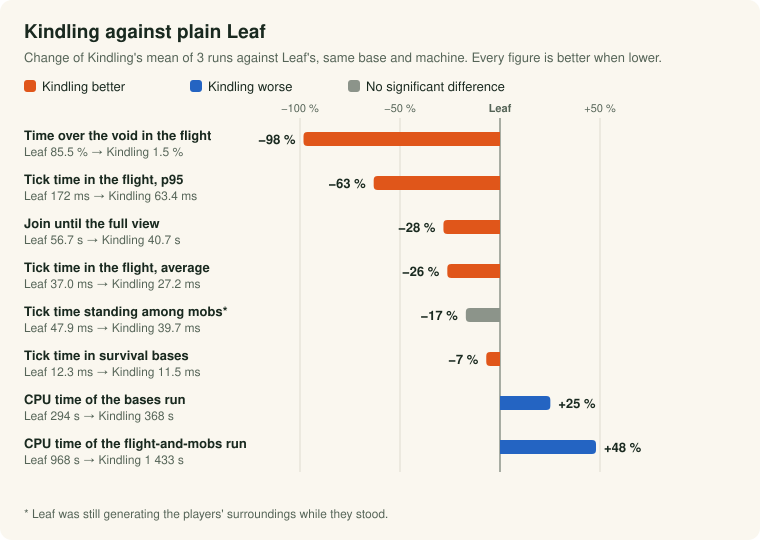

<div align="center">

<h1>
  <picture>
    <source media="(prefers-color-scheme: dark)" srcset="docs/branding/holzschnitt/banner-dark.svg">
    <source media="(prefers-color-scheme: light)" srcset="docs/branding/holzschnitt/banner-light.svg">
    
  </picture>
</h1>

**A [Leaf](https://github.com/Winds-Studio/Leaf) fork for small and mid-sized survival servers on shared hardware.**<br>
Vanilla behaviour, the full vanilla world, and every change measured.

[](https://github.com/jonax1337/Kindling/releases)
[](https://github.com/jonax1337/Kindling/actions/workflows/build.yml)


[](https://github.com/Winds-Studio/Leaf)
[](LICENSE.md)

[Website](https://jonax1337.github.io/Kindling/) ·
[At a glance](#-at-a-glance-kindling-against-plain-leaf) ·
[Features](#-what-kindling-adds-on-top-of-leaf) ·
[Getting started](#-getting-started) ·
[Configuration](#-configuration) ·
[Changelog](CHANGELOG.md) ·
[Measurements](docs/MEASUREMENTS.md)

</div>

---

Kindling makes the parts that hurt on a cheap VPS cheaper: fast players outrunning world generation, pregeneration, loading chunks from disk, and memory. Every change has to win against a reproducible load test ([`kindling-bench`](kindling-bench/README.md)), and changes that only win by altering gameplay (mob spawn throttling, distant entity tick skipping) are not defaults.

> [!WARNING]
> Kindling is young and has one production user so far; every build is published as a pre-release. Take a backup of your worlds before switching, as with any server software.

## 📊 At a glance: Kindling against plain Leaf

<picture>
  <source media="(prefers-color-scheme: dark)" srcset="docs/media/kindling-vs-leaf-dark.svg">
  
</picture>

| | Leaf | Kindling | |
| --- | ---: | ---: | :---: |
| 🛩️ Fliers over ungenerated void | 85.5 % | **1.5 %** | 🏆 |
| ⏱️ Tick time while flying, average / p95 | 37.0 / 172.0 ms | **27.2 / 63.4 ms** | 🏆 |
| 🚪 Join until the full view | 56.7 s | **40.7 s** | 🏆 |
| 🏠 Tick time in survival bases | 12.3 ms | **11.5 ms** | 🏆 |
| 🐄 Tick time standing among 1 200 mobs | 47.9 ms | 39.7 ms | 🤝 \* |
| 🧵 The same, release 26.3-12 in place of Leaf | 36.6 ms | 39.7 ms | 🔻 |
| 🔥 CPU time, flight run / bases run | **968 / 294 s** | 1 433 / 368 s | 🔻 |

Leaf `66f99f8e` against Kindling's build of 2026-10-29 (the coming 26.3-13), each with its own defaults, 3 runs each on a 4-core, 8-thread Intel i7-7700 under Linux. 🏆 Kindling better · 🤝 no significant difference · 🔻 Kindling costs more. \* Leaf's three standing runs spread by ±5.4 ms and it was still generating the players' surroundings while they stood.

**In short:** Kindling wins where players outrun world generation. In survival bases it is 0.8 ms (7 %) faster, standing among mobs it is not significantly different, and it uses 25 to 48 % more CPU time. Against its own release 26.3-12 the vanilla build runs the bases and the flight the same and ticks 8 % slower standing among 1 200 mobs (36.6 → 39.7 ms). Most of that comes from async pathfinding and async mob spawning being opt-in now: with `async.async-pathfinding.enabled` and `async.async-mob-spawning.enabled` switched on it ticks 37.5 ms (p = 0.051, short of the bench's rule, so a likely cause, not a proven one). They are not vanilla behaviour, so they stay off. [Details and method →](docs/measurements/vs-leaf.md#final-round-the-vanilla-build-of-2026-10-29-against-263-12-and-plain-leaf)

## ✨ What Kindling adds on top of Leaf

| | Feature | What you get | Measured |
| --- | --- | --- | --- |
| 🗺️ | **Built-in pregenerator** | `/pregen start <world> <radius>`, `pause`, `resume`, `status`; steps back when ticks get slow, resumes after a restart. No Chunky needed | 🧪 +59 % chunks per minute, −41 % CPU per chunk against its first version · [more](docs/measurements/pregeneration.md#pregeneration) |
| 🧭 | **Directional chunk loading** | The chunks ahead of a moving player are loaded first | 🏆 with the two rows below: 1.5 % instead of 85.5 % of a flight over the void against plain Leaf · [more](docs/measurements/chunks.md#elytra-test-new-chunks-ahead-of-fast-players) |
| ⚙️ | **Chunk workers sized for fast players** | Five eighths of the cores, at most five, never fewer than Paper (2 → 5 on 8 cores) | 🧪 0 % instead of 24 % void with eight fliers on 12 cores, against Paper's count · [more](docs/measurements/chunks.md#default-number-of-chunk-workers) |
| 🚦 | **Shorter generation queues** | Paper's automatic number of concurrent generations per player is capped at 32, so the order keeps up | 🧪 0.9 % instead of 38.5 % void on the 8-thread bench host, same CPU time · [more](docs/measurements/chunks.md#concurrent-generations-per-player) |
| 📦 | **Chunk loading without DataFixerUpper** | Saved block and biome palettes are read straight from NBT | 🛡️ same result, checked block by block; less chunk-worker time · [more](docs/measurements/chunks.md#loading-chunks-from-disk) |
| 🛟 | **Copies of unreadable chunks** | A stored chunk that cannot be read, including one the region file gives up on (truncated header or stream, bad length or compression), is copied to `<world>/kindling-quarantine/` before it is generated anew | 🛡️ checked with damaged region files; the region-file cases by unit tests · [more](docs/measurements/chunks.md#copies-of-unreadable-chunks) |
| 💤 | **Sleeping block entities, plugin-safe** | Idle hoppers, furnaces, brewing stands, crafters and chests stop ticking; Kindling makes Leaf's port act as Paper. Paper's temporary stack count during `InventoryMoveItemEvent` no longer wakes sleeping hoppers, and furnaces and brewing stands wake on in-place stack changes | 🏆 −8 % tick time in survival bases with identical items (on against off) · 🛡️ no duplicated items · [more](docs/measurements/ticking.md#sleeping-block-entities-after-the-fixes) |
| 🔌 | **Lithium ports** | Redstone wire power, unused mob sensors, the rain tick and map names, with vanilla's results | 🏆 −7 % in the bases in their own A/B · 🤝 not visible against 26.3-11 · [more](docs/measurements/ticking.md#lithium-ports) |
| 🐑 | **Cheaper natural spawning** | Entity types without a spawn cost skip the biome lookup | 🤝 no measurable change, equal spawn counts · [more](docs/measurements/ticking.md#natural-spawning-skipped-spawn-cost-lookups) |
| ⏱️ | **Cheaper lagging check** | Computes only the 5-second TPS average the check uses; proposed to Leaf as [#970](https://github.com/Winds-Studio/Leaf/pull/970) | 🧪 13.6 % → 3.4 % of an idle main thread (one profile each) · [more](docs/measurements/ticking.md#the-lagging-check-of-the-tick-loop) |
| 🧵 | **Async features, vanilla-safe** | Leaf's async entity tracker and player data saving are on, with Kindling's fixes (one mirrors Leaf PR #937). Async pathfinding and async mob spawning are opt-in, because a mob follows a new path a tick or more late and spawn counts can be stale | 🛡️ shared villager beds 5 and 3 → 0; the fixes cost nothing measurable with the options on · [more](docs/measurements/async.md#async-pathfinding-tracker-and-saving-after-the-fixes) |
| 🧬 | **Vanilla parity** | Where Leaf or Gale changed vanilla behaviour unconditionally, Kindling restores it: the `Vec3i` hash (redstone update order), goal order, entity order in a chunk section, the order inside-block checks visit blocks, the biome zoom cell, lightning, zombie villager cure, shapeless recipes and more; ten Gale and Leaf defaults are vanilla in a fresh config ([list](docs/measurements/vanilla-parity.md)) | 🤝 no cost in the bases (11.5 against 11.5 ms) or the flight (27.2 against 28.1 ms) against 26.3-12 · 🔻 standing among 1 200 mobs +8 % (36.6 → 39.7 ms), mostly the async options being off · 🛡️ parity scenarios pass · [more](docs/measurements/vanilla-parity.md) |
| 🔍 | **Differential test against the vanilla jar** | [`kindling-bench/vanilla-diff`](kindling-bench/vanilla-diff/README.md) runs Mojang's server and the jar under test on one seed and compares the saved worlds | 🛡️ contraptions (72 cells, 400 ticks): 0 block differences for this build, 8 for 26.3-12; worldgen mode not conclusive · [more](docs/measurements/vanilla-parity.md#vanilla-diff-against-mojangs-jar) |
| 🌍 | **Frontier pregeneration** | Opt-in: while nobody is online, generates a margin around the tiles players have visited | ⏸️ not measured · [more](docs/measurements/pregeneration.md#frontier-pregeneration) |
| 🎚️ | **Worker governor** | Opt-in (Linux): lowers the chunk worker count while the host crowds the main thread, raises it again when it is quiet | ⏸️ not measured · [more](docs/measurements/host.md#worker-governor) |
| 🔬 | **Biome zoom shortcut** | Opt-in: skips the zoom's distance math where all eight candidate biome cells hold one biome; the zoom itself now picks exactly vanilla's cell | 🤝 no tick time difference on or off (flight 27.2 → 27.7 ms, p = 0.49), no memory gain claimed · ⏸️ stays off · 🛡️ the cell choice is checked against vanilla's algorithm · [more](docs/measurements/vanilla-parity.md#biome-zoom) |
| 🩺 | **`/kindling doctor`** | Checks the machine and the settings and names the fix, including a "vanilla parity" finding for settings that differ from vanilla; on Linux also live CPU wait, steal and throttling | 🛡️ live readings agree with `/proc` within half a point · [more](docs/measurements/host.md#the-doctors-live-readings) |
| 🧠 | **Measured JVM advice** | G1 with `-XX:+UseCompactObjectHeaders` and a 2 GB heap | 🧪 −29 % resident memory at the same tick time · [more](docs/measurements/memory-jvm.md#jvm-and-heap) |
| 💾 | **Idle memory return** | Opt-in: gives memory back while nobody is online | ⏸️ about 1.45 GiB less resident memory with nobody online · [more](docs/measurements/memory-jvm.md#idle-memory) |
| 🪫 | **Worker priority** | Opt-in: chunk and I/O workers run at a lower OS priority on Linux | ⏸️ halves the main thread's wait for a CPU on the bench host · [more](docs/measurements/host.md#worker-priority-and-the-main-threads-wait-for-a-cpu) |
| 🏷️ | **Own `/version`** | Shows the Kindling build, commit and date, and checks for a newer release | — |

🏆 better, significant · 🤝 no measurable difference · 🛡️ correctness, no speed claim · 🧪 fewer than three runs or one profile, below the [three-run rule](docs/MEASUREMENTS.md#how-to-read-the-numbers) · ⏸️ opt-in, off by default. Every measurement names what it was compared with; the overview is in [docs/MEASUREMENTS.md](docs/MEASUREMENTS.md).

### How vanilla is Kindling?

Kindling aims at vanilla behaviour and has restored the deviations found in Leaf's and Gale's unconditional patches ([list](docs/measurements/vanilla-parity.md), [Leaf patches involved](docs/UPSTREAM.md#fixes-leaf-could-take)). That rests on reading code, unit tests, the parity scenarios and, for redstone and hopper contraptions, the [vanilla-diff test](kindling-bench/vanilla-diff/README.md): against Mojang's jar this build differs in 0 blocks of 72 contraption cells, release 26.3-12 in 8. World generation is not compared yet (the test is not conclusive there). Known deviations that remain:

- **Opt-in options differ from vanilla by design:** async pathfinding (a path arrives a tick or more late; with several target positions the navigation target is set when the result arrives), async mob spawning, and Leaf's optional options (`cache-biome` keys its cache by quart cell while the biome zoom depends on the position inside it, so it can return another block's biome).
- **Gale's zero-movement skip** (Leaf patch 0051) still skips side effects of a zero-length move that vanilla runs: the record for inside-block checks, `LivingEntity.checkFallDamage`'s fluid update when not in water, and the empty movement emission. Only the vertical collision flags and the ground state are restored.
- **Sculk catalysts** drop game events through Leaf's `listensToEvent` pre-filter when their block entity was removed but the listener is still registered.
- **Entity age with a despawn time:** where Paper's `entities.spawning.despawn-time` is set for a type, Leaf's compensation for ticks spent in weak-loaded chunks stays (it backs Leaf's despawn fix), so `getTicksLived()` and the saved age are larger than on Paper; a thrown projectile also checks despawn before its physics there. Without that setting the age counts as on Paper.
- **`-DLeaf.enableFMA=true`** (off by default) changes the rounding of `Entity.distanceTo`.
- **Sleeping hoppers** skip the `InventoryMoveItemEvent` attempts Paper fires on every check against a full destination, so a plugin sees fewer events than on Paper. With `gameplay.use-vanilla-hopper` a pull still wakes them.
- **`performance.optimize-block-entities`** no longer affects `World#getTileEntityCount`.

Everything else is Leaf, unchanged: Paper, Gale, Pufferfish and Purpur patches, Leaf's configuration (`config/leaf-global.yml`), its commands and its plugin compatibility. Swapping Leaf for Kindling needs no config migration. Kindling reports the brand id `winds-studio:leaf`, so plugins that check for Leaf keep working.

## 🚀 Getting started

1. Download the newest `kindling-26.3-<build>.jar` from [Releases](https://github.com/jonax1337/Kindling/releases).
2. Use it like a Leaf or Paper jar:
   ```bash
   java -Xms2G -Xmx2G -XX:+UseCompactObjectHeaders -jar kindling-26.3-<build>.jar --nogui
   ```
3. Leave `chunk-system.worker-threads` in `config/paper-global.yml` at `-1`: Kindling then picks the measured default (5 on 8 cores). If several servers share the machine and generate at the same time, lower it per server.
4. Pregenerate the area your players will use: `/pregen start world 5000`. Watch it with `/pregen status`.

> [!TIP]
> Kindling's defaults only apply when Leaf writes `config/leaf-global.yml` (and the Gale files) fresh. Coming from Leaf with an existing file, set `async.async-entity-tracker.enabled`, `async.async-playerdata-save.enabled` and `performance.sleeping-block-entity` to `true` yourself. For vanilla behaviour, `async.async-pathfinding.enabled`, `async.async-mob-spawning.enabled`, `performance.optimize-player-movement` and `performance.skip-map-item-data-updates-if-map-does-not-have-craftmaprenderer` must be `false`. `/kindling doctor` lists every setting of an old file that differs from vanilla (the "vanilla parity" finding) with the value to set; the Gale values are in [the parity list](docs/measurements/vanilla-parity.md#defaults-a-fresh-configuration-writes).

## 🔧 Configuration

All of Kindling's settings live in `config/leaf-global.yml`. What changed in which build: [CHANGELOG.md](CHANGELOG.md).

### Pregeneration

```yaml
performance:
  pregeneration:
    max-mspt: 40.0        # while the average tick takes longer: halves its chunks in flight, starts none
    max-parallel: 32      # upper bound for chunks in flight
    min-free-disk-gb: 2   # stops by itself when finishing would leave less free on the world's disk
    max-main-thread-wait: 0     # Linux: also throttles while the main thread waited for a CPU longer than this share of the last minute (e.g. 0.20); 0 (default) turns it off
    automatic:
      enabled: false      # true: start the radii below on every startup until done
      overworld-radius: 5000   # blocks around the world spawn, 0 for none
      nether-radius: 1000
      end-radius: 3000
```

```yaml
performance:
  pregeneration:
    frontier:
      enabled: false      # true: while nobody is online, generate a margin around the tiles players visited
      margin-chunks: 32   # 0 to 512, rounded up to whole 16-chunk tiles (32 = 5x5 tiles around each visited tile)
```

The frontier option notes the 16x16-chunk tile each player stands in (every second, only while someone is online) and, with nobody online, generates the tiles within the margin that do not exist yet, nearest first, at the chunk system's idle priority. It keeps the server awake while it works, pauses on the first join, leaves a world to an explicit or automatic `/pregen` run, stops at `min-free-disk-gb` and is throttled by `max-mspt`, `max-parallel` and `max-main-thread-wait`. **The world folder grows**: with the default margin every isolated visited tile adds up to 25 tiles (6 400 chunks, about 100 MiB at the disk guard's 16 KiB-per-chunk assumption, which was not measured for this feature). Its state is kept in `<world>/pregeneration-frontier.properties`. Off by default; not measured.

`/pregen start <world> <radius> [<x> <z>]` centres on the world spawn unless both `<x> <z>` are given, rounds the radius down to whole chunks, cuts it to the world border and says what it started. Permission: `kindling.command.pregen` (operators by default).

<details>
<summary><b>Status, state file and safety</b></summary>

- `/pregen status` shows why a run is slow or waiting (`throttled: 43 ms average > 40 ms`, `throttled: the main thread waited for a CPU 18 % of the last minute > 10 %`, `paused`, `paused: the disk would run out`) and the free disk space against what the rest of the run still needs (an estimate from the space the disk lost per chunk so far).
- Progress is kept in `<world>/pregeneration.properties` and belongs to the world's seed: a world regenerated under the same name starts over.
- While a run is working, `pause-when-empty-seconds` does not pause the server.
- The main thread's wait for a CPU comes from the doctor's host monitor (below); where it has no data (Windows, `host-monitor: false`) only `max-mspt` throttles.
- A run that throws pauses itself and stays resumable with `/pregen resume`, and the server goes on; a world that is unloaded and loaded again resumes; the state file is written on a thread of its own and, at a clean stop, with the exact index (a write still running at the stop is waited for up to 10 s, never raced).
- An automatic run that the border cut short counts as done and no longer starts over on every boot; if the border grew since, it runs again. A saved radius above 3 750 000 chunks is dropped with the "state is damaged" warning.
- If an empty server stopped for lack of disk space, the free space is checked every 30 s and the server wakes when there is room again. `/pregen start` before the first tick (for example from a plugin's `onEnable`) keeps the progress of the other worlds.

</details>

The wait throttle (`max-main-thread-wait`) is off by default: at 0.10 it cut pregeneration by more than half on the bench host, and on a VPS a nearly idle main thread already waits 11 to 14 % of its time, so it fired at baseline. 0.20 was not tested ([why](docs/measurements/host.md#worker-priority-and-the-main-threads-wait-for-a-cpu)).

### Doctor

```yaml
performance:
  doctor:
    startup-check: true   # log the warnings once the server has started
    host-monitor: true    # Linux only: sample the host every 5 seconds for the LIVE section
```

`/kindling doctor` (permission `kindling.command.doctor`, operators by default) reads this machine and server and lists what costs performance or memory, grouped into `WARN`, `INFO` and `OK`. Every `WARN` and `INFO` that has something to change names its fix and says whether the advice rests on a Kindling measurement or is general advice. Anything the system cannot tell (for example the Linux-only values on Windows) is skipped instead of guessed. With `startup-check` the server logs each `WARN` (one line with its fix) on its first tick; hints and OK lines only show in the command.

<details>
<summary><b>What it checks</b></summary>

- processors and the container CPU limit;
- `-Xmx` against the memory (heap plus about 600 MB must fit);
- the garbage collector, `-XX:+UseCompactObjectHeaders` and the AOT cache;
- chunk worker threads;
- the malloc arena limit (`MALLOC_ARENA_MAX` or `GLIBC_TUNABLES`), `-XX:TrimNativeHeapInterval` and transparent huge pages;
- view and simulation distance against the processors;
- network compression behind a proxy (a warning when the proxy runs on this machine or its place is unknown, a hint when it runs elsewhere);
- free disk space of the worlds (a warning below 5 GiB or 10 %);
- Kindling's recommended options in `leaf-global.yml` (a fresh file has them on, an older file keeps its values);
- vanilla parity: ten Leaf and Gale settings (projectile chunk-load limits, in-wall and line-of-sight intervals, villager item re-pickup, entity wake-up deviation, map updates, player movement processing, async pathfinding and async mob spawning) that an older file may still run at non-vanilla values. One `INFO` names each deviating value and the vanilla one; with none it is `OK`.

</details>

<details>
<summary><b>The LIVE section (Linux): is the lag my server or my host?</b></summary>

In plain sentences over the last minute (with the last 15 minutes in brackets):

- how long the main thread waited for a CPU: a warning above 10 % of the time it had work to do and at least 20 ms per second, because then other threads or processes on the machine compete with it;
- how long the chunk workers waited;
- how much CPU time the host took from this virtual machine (steal, a warning above 5 %);
- whether a container CPU limit throttled the server (a warning from 1 % of the periods);
- the nice value of a chunk worker thread, and whether `worker-priority` (below) is on and took effect.

A background thread samples these every 5 seconds from `/proc` and the cgroup files; it needs a minute to say something about the last minute. On a virtual machine a nearly idle main thread already shows 10 to 14 % wait (wake-up latency) but only about 3 ms per second, so the doctor names that as wake-up latency instead of warning about contention. How well the readings agree with `/proc`: [host measurements](docs/measurements/host.md).

</details>

### Worker governor

```yaml
performance:
  worker-governor:
    enabled: false    # true (Linux, needs doctor.host-monitor): lower the chunk worker count while the host crowds the main thread
    quiet-seconds: 60 # 5 to 3600: how long the host must stay quiet before a worker is added back
```

After every 5-second host sample the governor sorts the pressure on the main thread into four levels using the doctor's thresholds. Two high samples in a row (10 s) take one chunk worker away; `quiet-seconds` of quiet samples add one back. A worker that comes back and goes again within one quiet period doubles the wait (up to 8 times). The count stays between a quarter of the available processors (at least 1) and the configured or measured default; a Paper config reload sets the configured count again until the next sample. A removed worker finishes its current task, no chunk task is lost. `/kindling doctor` shows the status in the LIVE section. Gameplay does not change, only how fast chunks are generated. Off by default; not measured.

### Biome zoom shortcut

```yaml
performance:
  biome-zoom-shortcut:
    enabled: false   # true: answer a biome without the zoom's distance math when the 8 candidate cells hold one biome
```

Where the eight cells the zoom chooses from lie in one chunk column and the chunk sections store one identical biome each, the shortcut returns it, which is what the zoom would pick. It only reads, and takes the exact zoom otherwise. The zoom itself (always on) now chooses exactly vanilla's cell. Off by default: it showed no tick time difference in the mixed load ([measurements](docs/measurements/vanilla-parity.md#biome-zoom)).

### Worker priority

```yaml
performance:
  worker-priority:
    enabled: false   # true: chunk and I/O worker threads lower their own priority when they start
    nice: 10         # 0 to 19, higher is lower priority
```

Paper raises the main thread's Java priority and lowers its own workers', but HotSpot ignores Java thread priorities on Linux (with the default `-XX:ThreadPriorityPolicy=0`), so there the chunk workers compete with the main thread on equal terms. With `enabled`, each chunk and I/O worker thread lowers its own priority. It stays off until a run under real load on a VPS confirms the bench host's result ([measurements](docs/measurements/host.md#worker-priority-and-the-main-threads-wait-for-a-cpu)).

<details>
<summary><b>How it works</b></summary>

- On Linux each worker gives itself the nice value `nice` through the C library (`setpriority` with its thread id from `gettid`, which needs glibc 2.30 or musl 1.2.2); on Windows and macOS it lowers its Java thread priority instead.
- A priority is never raised: a thread that already runs at a higher nice value keeps it.
- If the call fails, the server logs it once and the workers keep their priority.
- Threads that a worker starts inherit its nice value. The setting applies to threads started after it is read, so restart the server after changing it.
- The call is a restricted method of the Foreign Function & Memory API. The Paperclip jar's manifest carries `Enable-Native-Access: ALL-UNNAMED`, which also covers the server classes Paperclip loads, so `java -jar` prints no warning. Started any other way (for example `java -cp … io.papermc.paperclip.Main`), Java prints a "restricted method" warning the first time; `--enable-native-access=ALL-UNNAMED` silences it.

</details>

### Directional chunk loading

```yaml
performance:
  directional-chunk-loading:
    enabled: true
    look-ahead-ticks: 60
```

It only reorders the queue: which chunks get loaded does not change, only the order.

### Idle memory

```yaml
performance:
  idle-memory:
    enabled: false      # true: give memory back while nobody is online
    after-seconds: 300  # how long the server must be empty first
```

After `after-seconds` without players the server gives heap and native memory back, once per idle period. A heap with `-Xms` equal to `-Xmx` cannot shrink; `/kindling doctor` says so, and `-Xms512M -Xmx2G` lets the idle collection give heap back. The tick spike when players rejoin after the heap shrank was not measured ([measurements](docs/measurements/memory-jvm.md#idle-memory)).

<details>
<summary><b>How it works</b></summary>

- It runs a full garbage collection through the JVM's diagnostic command, so it works with `-XX:+DisableExplicitGC`, with the free-heap ratios lowered to 5 and 10 percent for that one collection.
- Then it trims the native heap on glibc Linux with Java 25 (unless `-XX:TrimNativeHeapInterval` is set), and logs the heap and resident memory before and after.
- Nothing runs while a player is online or a pregeneration is working, and the period starts over when either begins.

</details>

## 📦 Building

Java 25 and Git are required (on Windows also `git config --global core.longpaths true`).

```bash
./gradlew applyAllPatches
./gradlew createPaperclipJar   # leaf-server/build/libs/leaf-paperclip-26.3.local-SNAPSHOT.jar
```

## 📚 Documentation

| To learn | Read |
| --- | --- |
| What changed in each build | [CHANGELOG.md](CHANGELOG.md) |
| Why each change exists, and what it measured | [docs/MEASUREMENTS.md](docs/MEASUREMENTS.md) |
| What is open, and what was dropped | [docs/ROADMAP.md](docs/ROADMAP.md) |
| How Kindling follows Leaf | [docs/UPSTREAM.md](docs/UPSTREAM.md) |
| How to contribute | [CONTRIBUTING.md](CONTRIBUTING.md) |
| How to measure a change | [kindling-bench/README.md](kindling-bench/README.md) |
| Logos, banners and brand assets | [Brand kit](docs/branding/README.md) |

## License and credits

Kindling inherits the licenses of its upstream projects: patches under MIT unless their header says otherwise, binaries under GPL-3.0-only. See [LICENSE.md](LICENSE.md).

Kindling would be nothing without [Leaf](https://github.com/Winds-Studio/Leaf) by Winds Studio and the projects Leaf builds on: [Paper](https://github.com/PaperMC/Paper), [Gale](https://github.com/GaleMC/Gale), [Pufferfish](https://github.com/pufferfish-gg/Pufferfish), [Purpur](https://github.com/PurpurMC/Purpur) and the forks credited in Leaf's README. Please report problems that plain Leaf has as well to Leaf, not here.
