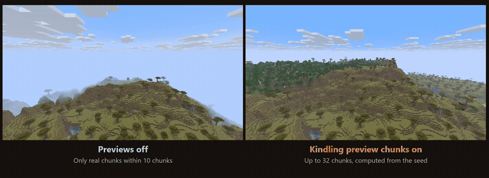
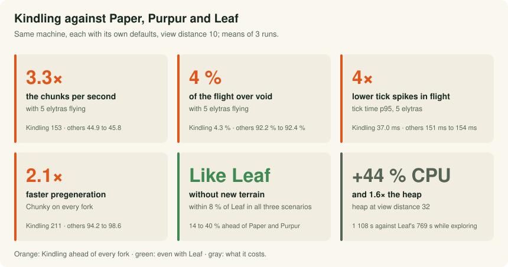

<div align="center">

<h1>
  <picture>
    <source media="(prefers-color-scheme: dark)" srcset="docs/branding/pixel-leaf/banner-dark.svg">
    <source media="(prefers-color-scheme: light)" srcset="docs/branding/pixel-leaf/banner-light.svg">
    
  </picture>
</h1>

**A [Leaf](https://github.com/Winds-Studio/Leaf) fork for servers whose players explore: the terrain keeps up with elytras.**<br>
Vanilla behaviour, the full vanilla world, and every change measured.

[](https://github.com/jonax1337/Kindling/releases)
[](https://github.com/jonax1337/Kindling/actions/workflows/build.yml)


[](https://github.com/Winds-Studio/Leaf)
[](LICENSE.md)

[Website](https://jonax1337.github.io/Kindling/) ·
[Getting started](docs/getting-started.md) ·
[Documentation](docs/README.md) ·
[Measurements](docs/MEASUREMENTS.md) ·
[Changelog](CHANGELOG.md)

</div>

---

Kindling puts the whole machine to work where Leaf and Paper fall behind: players outrunning world generation, pregeneration and loading chunks from disk. On new terrain it generates 2.5 to 4.3 times the chunks of Leaf and spends more CPU time to do it, on cores that would otherwise sit idle; without new terrain it ticks like Leaf. It does not make a server fit on smaller hardware. Every change has to win a reproducible load test ([`kindling-bench`](kindling-bench/README.md)). Changes that only win by altering gameplay are never defaults.

> [!WARNING]
> Kindling is young and every build is a pre-release. Back up your worlds before switching, as with any server software.

## Far view without a client mod

<a href="docs/media/preview-chunks.mp4"></a>

Same seed, same flight at 30 blocks a second, server view distance 10, client render distance 32. Right: `network.preview-chunks` (opt-in). Beyond the view distance the server sends previews computed from the world seed or read from the save; they are never loaded, saved or ticked, and the real chunk replaces each one up close. The top block matches the real chunk in 87.8 % of the columns, as often as two real generations of the chunk match each other. [Full video](docs/media/preview-chunks.mp4) · [measurements](docs/measurements/preview-chunks.md) · [settings](docs/reference/configuration.md#networkpreview-chunks)

## Against Paper, Purpur and Leaf

<picture>
  <source media="(prefers-color-scheme: dark)" srcset="docs/media/all-forks-tiles-dark.svg">
  
</picture>

| Scenario | Paper | Purpur | Leaf | Kindling |
| --- | ---: | ---: | ---: | ---: |
| New chunks per second, 5 elytras / 8 players exploring | 46 / 70 | 45 / 68 | 45 / 65 | **153 / 162** |
| Time over ungenerated void, 5 elytras / 8 players | 92 / 82 % | 92 / 82 % | 92 / 82 % | **4 / 0 %** |
| New chunks per second at view distance 32, 5 elytras / 8 players | 34 / 61 | 35 / 60 | 35 / 57 | **150 / 173** |
| Join until the full view, 8 players | 49.8 s | 50.3 s | 49.9 s | **28.5 s** |
| Tick time while flying with elytras, p95 / average | 151 / 38.1 ms | 154 / 38.8 ms | 151 / 37.2 ms | **37 / 22.0 ms** |
| Pregeneration with Chunky, chunks per second | 99 | 94 | 98 | **211** |
| Tick time among 1 200 standing mobs | 47.3 ms | 51.5 ms | 36.2 ms | **33.2 ms** |
| Tick time in survival bases | 13.3 ms | 13.3 ms | 11.9 ms | 11.0 ms |
| Tick time among working villagers | 12.3 ms | 14.4 ms | 8.4 ms | 8.6 ms |
| Tick time flying over a pregenerated world | 29.1 ms | 30.4 ms | 25.2 ms | 25.0 ms |
| Tick time while exploring at view distance 32 | 41.9 ms | 41.8 ms | **36.0 ms** | 50.9 ms |
| CPU time, bases / exploring | 245 / 804 s | 249 / 820 s | **246 / 769 s** | 271 / 1 108 s |

Paper build 237, Purpur build 2655, Leaf release 26.3-15 and Kindling with preview chunks off, each with its own defaults; view distance 10 unless named; 6 GB heap; 3 runs each on a 4-core, 8-thread i7-7700 under Linux. Kindling's rows with 8 exploring players and its pregeneration come from the build with [shared data for uniform sections](docs/measurements/memory-jvm.md#shared-data-for-uniform-sections), the other Kindling rows from the build before. Bold marks the better of Leaf and Kindling where `compare.py` marks the difference.

Where players reach new terrain, Kindling generates 2.5 to 4.3 times the chunks of Leaf and the players spend 0 to 4 % of the flight over void instead of 69 to 92 %; Paper, Purpur and Leaf generate at about the same rate. Without new terrain Kindling ticks like Leaf and 14 to 40 % faster than Paper and Purpur. The price is CPU time, 44 % more than Leaf while exploring, on cores the other forks leave idle. The extra 10 % in the bases is spent once, in the warm-up that generates the start area; the 90 s measured among the bases cost the same CPU time as on Leaf. At view distance 32 Kindling gives 8 exploring players the whole view, which none of them reaches on the other forks; there its average tick time is higher than Leaf's and it holds 1.6 times the heap. At view distance 10 its heap after GC is below Leaf's (967 against 1 117 MB). [Method and all numbers](docs/measurements/vs-leaf.md).

## Features

| Feature | Default |
| --- | --- |
| **Directional chunk loading:** chunks ahead of a moving player load first | on |
| **Chunk workers sized for fast players:** five eighths of the cores, at most five, never fewer than Paper; generation queues capped at 32 per player | on |
| **Worker demand:** every chunk worker runs only while new terrain waits | on |
| **Worker priority:** chunk and I/O workers give way to the main thread (Linux) | on |
| **Compiled world generation:** material rules and terrain density without vanilla's lambda trees and dead branches, with vanilla's results | on |
| **Faster chunk loading:** saved palettes read straight from NBT, without DataFixerUpper | on |
| **Sleeping block entities:** idle hoppers, furnaces, brewing stands, crafters and chests stop ticking, plugin-safe | on |
| **Lithium ports:** redstone wire power, unused mob sensors, rain tick, map names | on |
| **Built-in pregenerator:** `/pregen`, steps back when ticks get slow, resumes after a restart | manual |
| **Copies of unreadable chunks** to `kindling-quarantine/` before they are generated anew | on |
| **Vanilla parity:** Leaf and Gale changes to vanilla behaviour restored ([list](docs/reference/vanilla-differences.md)) | on |
| **`/kindling doctor`:** checks the machine and settings and names the fix | on |
| **`/kindling stress`:** load your own server in a throwaway world and watch MSPT | command |
| **Preview chunks:** vanilla clients, no mod, see terrain up to 32 chunks away while the server loads only its view distance ([measured](docs/measurements/preview-chunks.md)) | opt-in |
| **Frontier pregeneration**, **worker governor**, **idle memory return**, **biome zoom shortcut** | opt-in |

What each feature measured: [Measurements](docs/MEASUREMENTS.md). Everything else is Leaf, unchanged: Paper, Gale, Pufferfish and Purpur patches, Leaf's configuration and its plugin compatibility. Kindling reports the brand id `winds-studio:leaf`.

## Quick start

```bash
java -Xms3G -Xmx3G -XX:+UseCompactObjectHeaders -jar kindling-26.3-<build>.jar --nogui
```

Download the jar from [Releases](https://github.com/jonax1337/Kindling/releases). New to Kindling: [Getting started](docs/getting-started.md). Coming from Leaf: [Switch from Leaf](docs/guides/switch-from-leaf.md), because an existing `leaf-global.yml` keeps Leaf's defaults.

## Documentation

| | |
| --- | --- |
| [Getting started](docs/getting-started.md) | First server, first pregeneration |
| [Guides](docs/README.md#guides) | Switch from Leaf, memory and JVM flags, pregeneration, finding lag |
| [Configuration](docs/reference/configuration.md) and [commands](docs/reference/commands.md) | Every setting and command |
| [Vanilla differences](docs/reference/vanilla-differences.md) | What is restored and what still differs |
| [Measurements](docs/MEASUREMENTS.md) | Why each change exists and what it measured |
| [Changelog](CHANGELOG.md) and [roadmap](docs/ROADMAP.md) | What changed, what is next |
| [Contributing](CONTRIBUTING.md) | Building, patches, the bench |

## License and credits

Patches under MIT unless their header says otherwise, binaries under GPL-3.0-only; see [LICENSE.md](LICENSE.md).

Kindling builds on [Leaf](https://github.com/Winds-Studio/Leaf) by Winds Studio and the projects Leaf builds on: [Paper](https://github.com/PaperMC/Paper), [Gale](https://github.com/GaleMC/Gale), [Pufferfish](https://github.com/pufferfish-gg/Pufferfish), [Purpur](https://github.com/PurpurMC/Purpur) and the forks credited in Leaf's README. Please report problems that plain Leaf has as well to Leaf.
