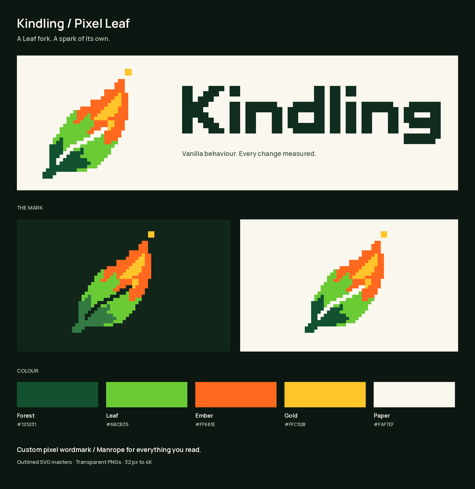

# Kindling brand kit

Kindling's mark is a **pixel leaf with a burning tip**: the green leaf reflects its Leaf foundation, while the orange flame gives Kindling its own identity. A transparent stepped vein runs through the leaf. The bold, custom pixel wordmark belongs to the same visual language.



[Open the asset gallery](index.html) for light, dark and monochrome downloads, background previews and a grid inspection.

## Assets

The current masters and exports live in `pixel-leaf/`. `light` means intended for light surfaces; `dark` means intended for dark surfaces. Dark variants lift the forest shade to keep the stem visible.

| Asset | Names | PNG dimensions | Background |
| --- | --- | --- | --- |
| Symbol | `icon-color`, `icon-inverse` | 1024 × 1024 | Transparent, including the vein |
| One-color symbol | `icon-mono-black`, `icon-mono-white` | 1024 × 1024 | Transparent, including the vein |
| High-resolution symbol | `icon-4k` | 4096 × 4096 | Transparent |
| Horizontal logo | `logo-horizontal-light`, `logo-horizontal-dark` | 1600 × 420 | Transparent |
| Stacked logo | `logo-stacked-light`, `logo-stacked-dark` | 1024 × 1024 | Transparent |
| Wordmark | `wordmark-light`, `wordmark-dark` | 1600 × 480 | Transparent |
| Avatar | `avatar-light`, `avatar-dark` | 1024 × 1024 | Solid |
| README banner | `banner-light`, `banner-dark` | 1600 × 500 | Solid |
| Social preview | `social-preview-light`, `social-preview-dark` | 1280 × 640 | Solid |
| Browser / app icon | `app-icon` | 192 × 192 | Solid |
| Minecraft server icon | `server-icon.png` | 64 × 64 | Transparent, including the vein |
| Small symbol | `icon-32-light.png`, `icon-32-dark.png` | 32 × 32 | Transparent |
| Apple touch icon | `apple-touch-icon.png` | 180 × 180 | Solid |

Every asset without an explicit `.png` suffix above has both an SVG master and a PNG export. SVGs contain rectangles and outlined paths, including lettering: no embedded bitmaps, external fonts, scripts or network references. The four format-specific PNGs are raster exports of the same artwork.

## Grid and transparency

The mark is authored on a **32 × 32 grid**. Each occupied cell has one of four solid colors. The leaf vein and outer space are genuinely empty: changing the background changes what shows through them. Solid banners and avatars simply put a background behind the same mark.

The wordmark has a separate **49 × 11 grid**. The capital K has a two-cell vertical stem and three-cell stepped diagonals for optical weight. The lowercase letters use two-cell strokes. Use the supplied wordmark, rather than trying to reproduce it with a typeface.

Prefer integer scale factors for raster pixel art. The 32- and 64-pixel icons use exact one- and two-pixel cells. SVGs scale to any size; sharp edges may snap slightly at fractional screen scales. The platform-specific 180-pixel touch icon uses nearest-neighbor resampling.

## Color and typography

| Role | Color | Use |
| --- | --- | --- |
| Forest | `#125231` | Shaded lower leaf; `#337B43` on dark surfaces |
| Leaf | `#6BCB35` | Main leaf body |
| Ember | `#FF681E` | Flame |
| Gold | `#FFC52B` | Hot core and detached spark |
| Paper | `#FAF7EF` | Light surfaces and dark-theme lettering |
| Ink | `#102D20` | Light-theme lettering |
| Night | `#0B1710` | Main dark surface |

Machine-readable values, including readable text accents, are in [palette.json](palette.json). Use the mark colors for artwork; interface links use `#FF8B4C` on dark surfaces or `#C5410B` on light surfaces. The website uses brighter `#86DC57` for green text accents.

The logo uses original pixel lettering. **Manrope** is the supporting typeface: weight 800 for display headings, 650–700 for labels, and 400–500 for body copy. Its original variable font and SIL Open Font License notice are in `fonts/`. The website serves its existing local WOFF2 subset.

## Use in the repository and website

The root README selects a banner for the visitor's theme:

```html
<picture>
  <source media="(prefers-color-scheme: dark)" srcset="docs/branding/pixel-leaf/banner-dark.svg">
  <source media="(prefers-color-scheme: light)" srcset="docs/branding/pixel-leaf/banner-light.svg">
  
</picture>
```

The website imports its logo and mark from this kit through `@brand`. Its production build copies the social preview, SVG/PNG favicons and touch icon under stable filenames. No server behavior, plugin brand identifier or world data format is part of the visual identity.

## Social profiles and Minecraft

Use [social-preview-dark.png](pixel-leaf/social-preview-dark.png) for the repository's GitHub social-preview setting, and [avatar-dark.png](pixel-leaf/avatar-dark.png) for a profile avatar. These external settings are separate from the repository files.

The avatar includes space for a circular crop. Copy [server-icon.png](pixel-leaf/server-icon.png) into a Minecraft server directory when deploying the visual update. Verify the result in the server list and in real social-card crops.

## Usage rules

- Preserve proportions, color roles and the detached spark. Do not blur, rotate or add gradients.
- Keep at least two grid cells of clear space around the visible symbol.
- Use a solid, quiet surface beneath the mark so its transparent vein stays legible.
- Prefer at least 32 pixels for the symbol. Use the square app icon for browser tabs.
- Use dark variants on dark surfaces; monochrome variants retain the open vein.
- Banners repeat the repository's positioning; they add no new performance claim.

## Rebuilding

From the repository root, with Pillow and fonttools installed:

```sh
python docs/branding/generate_pixel_brand.py
```

The generator contains the authored mark and glyph grids and regenerates the current SVG/PNG exports, overview, palette and [export manifest](exports.json). It does not alter the exploratory concept images.

`holzschnitt/` and its Fraunces source font remain as legacy assets. Current consumers use `pixel-leaf/` and Manrope.
