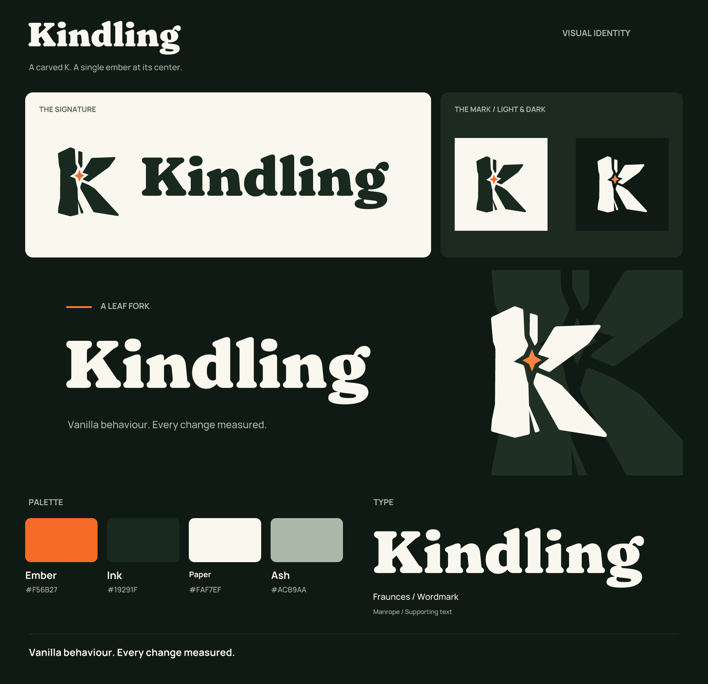

# Kindling brand kit

Kindling's identity is a carved **K** with an ember at its center. The bold silhouette refers to kindling wood; the small orange spark brings the mark to life. A warm, heavy serif wordmark carries the same woodcut character.

The symbol, wordmark, colors and layouts form one identity across the repository, link previews and server icon. Light, dark and monochrome assets are applications of the same logo.



## Assets

The assets are in `holzschnitt/`. Every SVG master has a matching PNG export. `light` means intended for light backgrounds; `dark` means intended for dark backgrounds. Transparent PNGs retain genuine alpha.

| Asset | SVG / PNG names | PNG dimensions | Background |
| --- | --- | --- | --- |
| Symbol only | `icon-color`, `icon-inverse` | 1024 x 1024 | Transparent |
| One-color symbol | `icon-mono-black`, `icon-mono-white` | 1024 x 1024 | Transparent |
| Horizontal logo | `logo-horizontal-light`, `logo-horizontal-dark` | 1600 x 420 | Transparent |
| Stacked logo | `logo-stacked-light`, `logo-stacked-dark` | 1000 x 1000 | Transparent |
| Wordmark | `wordmark-light`, `wordmark-dark` | 1600 x 480 | Transparent |
| Avatar | `avatar-light`, `avatar-dark` | 1024 x 1024 | Solid |
| README banner | `banner-light`, `banner-dark` | 1600 x 500 | Solid |
| Social preview | `social-preview-light`, `social-preview-dark` | 1280 x 640 | Solid |

Additional PNGs: `server-icon.png` (64 x 64, dark background), `icon-32-light.png` and `icon-32-dark.png` (32 x 32, transparent).

All SVGs use real vector paths, including typography. They have no embedded raster images or external font dependencies. Use the SVG masters for new export sizes rather than enlarging a PNG.

## Repository README

The root README uses the banner below. The paths are relative to the repository root. The theme-aware markup follows [GitHub's documented picture pattern](https://docs.github.com/en/get-started/writing-on-github/getting-started-with-writing-and-formatting-on-github/quickstart-for-writing-on-github#adding-an-image-to-suit-your-visitors).

```html
<h1>
  <picture>
    <source media="(prefers-color-scheme: dark)" srcset="docs/branding/holzschnitt/banner-dark.svg">
    <source media="(prefers-color-scheme: light)" srcset="docs/branding/holzschnitt/banner-light.svg">
    
  </picture>
</h1>
```

For a compact header, use `logo-horizontal-light.svg` and `logo-horizontal-dark.svg` in the same picture element with an image width of 560. PNGs with matching names are available where SVG is unsupported. Use one full logo per header, keeping its clear space intact.

The README badges use Shields' `for-the-badge` style with the Ink label background, Ember highlights and muted supporting colors. The build badge retains its live status color. See [Shields' style parameters](https://shields.io/badges/git-hub-branch-status).

## GitHub social preview and avatar

Use the [dark social preview](holzschnitt/social-preview-dark.png) for repository link cards. Upload the PNG in repository **Settings > General > Social preview > Edit**; adding it to Git alone does not change that setting. The supplied previews are 1280 x 640 pixels and below 1 MB, following [GitHub's recommendations](https://docs.github.com/en/repositories/managing-your-repositorys-settings-and-features/customizing-your-repository/customizing-your-repositorys-social-media-preview).

Use `avatar-light.png` or `avatar-dark.png` for an organization or profile avatar. Their clear space accommodates a circular crop. The 64-pixel `server-icon.png` can be copied separately to a Minecraft server directory.

## Color and typography

| Role | Light surfaces | Dark surfaces |
| --- | --- | --- |
| Ember accent | `#F56B27` | `#FF823F` |
| Foreground | `#19291F` | `#FAF7EF` |
| Surface | `#FAF7EF` | `#101A14` |
| Secondary copy | `#556457` | `#ACB9AA` |

Machine-readable values are in `palette.json`. Orange highlights the central ember; copy uses the foreground colors.

- **Wordmark:** Fraunces, weight 900, optical size 9, softness 100, wonky 0.
- **Supporting text:** Manrope Medium / Bold, weights 500 / 700.

Original variable fonts and their SIL Open Font License notices are included in `fonts/`. Font sources: [Fraunces](https://github.com/google/fonts/tree/main/ofl/fraunces), [Manrope](https://github.com/google/fonts/tree/main/ofl/manrope). These notices cover the font files; the repository's software license is unchanged.

Use the supplied outlined wordmark for the identity. Ordinary live text does not reproduce its optical spacing exactly.

## Usage

- Keep the original proportions and built-in clear space. Do not stretch, rotate or add outlines or shadows.
- Use light assets on pale surfaces and dark assets on dark surfaces. The monochrome symbols use true black and white.
- Prefer at least 32 pixels for the standalone symbol. Check the central spark at smaller sizes.
- The banner copy reflects the repository's existing positioning and introduces no new measured performance claim.
- Asset validation covers SVG structure, dimensions, alpha and local links. GitHub presentation, avatar crops and the Minecraft server-list appearance remain manual integration checks.

## Package contents

`brand-overview.svg` / `.png` presents the identity. `index.html` is an offline gallery with asset downloads. `exports.json` lists the 17 SVG/PNG pairs and their dimensions; the kit also contains 3 small PNGs.
